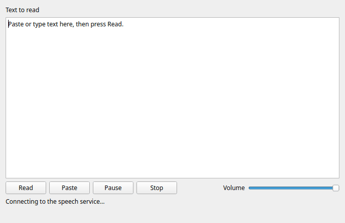

# Reader Assistant

A local, offline desktop tool that reads text aloud. Copy text in any application, press a keyboard shortcut, and hear it. The language is detected from the text, and a local voice reads it.

No cloud speech service, no account, no network use while reading. Text does not leave your computer.



*The window reading English, Hebrew and Russian text with the real voices. The recording was made without sound. It is regenerated by `scripts/make_demo_gif.py`.*

- **Languages:** English, Russian and Hebrew. The language is detected automatically; there is no language selector.
- **Platform:** Linux desktop with a **Wayland** session (the clipboard is read with `wl-paste`). X11 is not supported. Developed and tested on GNOME with Wayland.
- **Licence:** the application is GPL-3.0-or-later (see [LICENSE](https://github.com/kursluzz/reader-assistant/blob/main/LICENSE)). Voice models have their own licences, listed in [Voices and licences](#voices-and-licences).

## Status

Version 0.1.0, pre-alpha. The core service, the keyboard shortcut and the window are implemented and tested on the developer's machine. Milestones M0 to M5-4C are accepted. The final release checks are in progress. See [Limitations](#limitations).

## Requirements

- Linux with a Wayland session and GNOME (or another desktop where you can set a custom shortcut).
- Python 3.12 or newer. [uv](https://docs.astral.sh/uv/) installs and manages the Python environment.
- System packages:
  ```bash
  sudo apt install wl-clipboard libportaudio2
  ```
  `wl-clipboard` provides `wl-paste`, which the shortcut uses to read the clipboard. `libportaudio2` is needed for sound output. `libnotify-bin` (`notify-send`) is optional; it shows the "not running" notification.

## Installation

There are two ways to install. For everyday use, install the `reader-assistant` command with uv. For development, run from a clone. Upgrade, uninstall and the location of your data are described in [docs/INSTALLATION.md](https://github.com/kursluzz/reader-assistant/blob/main/docs/INSTALLATION.md).

### As an installed command (recommended)

[uv](https://docs.astral.sh/uv/) puts the program in its own environment. It does not touch your system Python or the repository:

```bash
uv tool install --python 3.12 'reader-assistant[desktop]'
```

The `desktop` extra adds both voice engines, sound output and the window (see the table below). The package is not on PyPI yet. Until the first release is published, install from a clone:

```bash
git clone https://github.com/kursluzz/reader-assistant.git
cd reader-assistant
uv tool install --python 3.12 '.[desktop]'
```

- Upgrade: `uv tool upgrade reader-assistant`. Stop the running service first, and start it again afterwards.
- Uninstall: `uv tool uninstall reader-assistant`. This removes the program only. Voice models, configuration and logs stay.
- Check: `reader-assistant info`.

### From a clone (development)

Clone the repository and install the dependencies. Choose the extras you need (see the table below), or install everything:

```bash
git clone git@github.com:kursluzz/reader-assistant.git
cd reader-assistant
uv sync --all-extras
```

| Extra | Installs | Needed for |
|---|---|---|
| `kokoro` | `kokoro-onnx` (MIT) | English voice |
| `piper` | `piper-tts` (GPL-3.0-or-later) | Russian and Hebrew voices |
| `audio` | `sounddevice` | Sound output |
| `gui` | PySide6 (`pyside6-essentials`, `shiboken6`) | The window (`serve --gui`) |
| `desktop` | `kokoro`, `piper`, `audio` and `gui` together | The complete desktop application |

Without `kokoro` or `piper`, the matching language cannot be spoken. Without `audio`, nothing is played. The headless service and the shortcut work without `gui`.

### Voice model files

The voice model files are not in the repository and are not downloaded by the application. Download them once, into the models directory. By default that is `~/.local/share/reader-assistant/models` (`$XDG_DATA_HOME/reader-assistant/models`). `RA_MODELS_DIR` overrides it. Check the path with `uv run reader-assistant info`.

```bash
MODELS=~/.local/share/reader-assistant/models
mkdir -p "$MODELS/kokoro" "$MODELS/piper/he_IL-saspeech-medium" "$MODELS/piper/ru_RU-denis-medium"

# English (Kokoro)
curl -L -o "$MODELS/kokoro/kokoro-v1.0.onnx" https://github.com/thewh1teagle/kokoro-onnx/releases/download/model-files-v1.1/kokoro-v1.0.onnx
curl -L -o "$MODELS/kokoro/voices-v1.0.bin" https://github.com/thewh1teagle/kokoro-onnx/releases/download/model-files-v1.1/voices-v1.0.bin

# Hebrew (Piper)
curl -L -o "$MODELS/piper/he_IL-saspeech-medium/he_IL-saspeech-medium.onnx" https://huggingface.co/rhasspy/piper-voices/resolve/main/he/he_IL/saspeech/medium/he_IL-saspeech-medium.onnx
curl -L -o "$MODELS/piper/he_IL-saspeech-medium/he_IL-saspeech-medium.onnx.json" https://huggingface.co/rhasspy/piper-voices/resolve/main/he/he_IL/saspeech/medium/he_IL-saspeech-medium.onnx.json

# Russian (Piper)
curl -L -o "$MODELS/piper/ru_RU-denis-medium/ru_RU-denis-medium.onnx" https://huggingface.co/rhasspy/piper-voices/resolve/main/ru/ru_RU/denis/medium/ru_RU-denis-medium.onnx
curl -L -o "$MODELS/piper/ru_RU-denis-medium/ru_RU-denis-medium.onnx.json" https://huggingface.co/rhasspy/piper-voices/resolve/main/ru/ru_RU/denis/medium/ru_RU-denis-medium.onnx.json
```

Compare each file's SHA-256 (`sha256sum <file>`) with the value in [docs/MODEL_MANIFEST.toml](https://github.com/kursluzz/reader-assistant/blob/main/docs/MODEL_MANIFEST.toml) before you use it. The Piper `.onnx.json` file must sit next to its `.onnx` file.

## Running it

There is one speech service. It owns the voices and the sound output. Everything else talks to it. The commands below use `uv run` in a clone. With the installed command, run `reader-assistant` directly.

- **Background service (headless):** `uv run reader-assistant serve`. It runs in the foreground until you press Ctrl+C. To start it at login, see [docs/CLIPBOARD.md](https://github.com/kursluzz/reader-assistant/blob/main/docs/CLIPBOARD.md#2-start-the-service).
- **Window:** `uv run reader-assistant serve --gui`. The window is a client of the service. If a service is already running, the window connects to it. If not, the window starts one in a separate process and connects. Closing the window disconnects it, and the service keeps running. The window never runs a second service.
- **Keyboard shortcut (Win+Shift+O in the author's setup):** reads the clipboard through the running service. It works whether or not the window is open. Set it up as described in [docs/CLIPBOARD.md](https://github.com/kursluzz/reader-assistant/blob/main/docs/CLIPBOARD.md#3-set-up-the-gnome-keyboard-shortcut).

### Reading Claude Code answers aloud

In a Claude Code session, `/read-last` reads the last answer of that session through the service. It needs a one-time hook setting. See [docs/CLAUDE_CODE.md](https://github.com/kursluzz/reader-assistant/blob/main/docs/CLAUDE_CODE.md).

### Using the window

- Type or paste text into the box, then press **Read**. **Paste** replaces the text in the box with the clipboard text.
- **Pause** and **Stop** control playback. **Volume** sets the output level.
- The status line shows what the service is doing, including the detected language and voice.
- If the service cannot be reached, the window says so. After a few automatic attempts it shows **Retry**.

### Checking the installation

```bash
uv run reader-assistant info          # configuration, paths, version
uv run reader-assistant --version
```

## Configuration

Settings come from, in increasing precedence: built-in defaults, a TOML file, environment variables and command-line options.

- File: `$XDG_CONFIG_HOME/reader-assistant/config.toml` (usually `~/.config/reader-assistant/config.toml`), or any file given with `--config PATH`.
- Environment: `RA_LOG_LEVEL`, `RA_MODELS_DIR`.
- Command line: `--log-level LEVEL`.

```toml
log_level = "INFO"          # DEBUG, INFO, WARNING, ERROR
log_to_file = true          # logs go to $XDG_STATE_HOME/reader-assistant/logs
default_language = "auto"   # auto, en, ru, he. Breaks ties only (see below).
volume = 1.0                # 0.0 to 1.0. Applied.
speech_rate = 1.0           # Accepted and shown by `info`, but not applied yet.
# default_voice = "af_heart" # Accepted and shown by `info`, but not applied yet.
```

- `default_language` only decides a tie: when two languages have the same number of letters in the text, the configured language wins. Otherwise the language is always detected from the text.
- Unknown keys and invalid values are rejected with a clear message and exit code 2.

Logs are written to `~/.local/state/reader-assistant/logs/reader-assistant.log` (rotating, 1 MB, three files). Downloaded voices live under the models directory and are never part of the repository.

## Troubleshooting

| What you see | What to do |
|---|---|
| A notification says "Reader Assistant is not running" (or the shortcut exits with status 3) | Run `uv run reader-assistant serve`, or open the window with `serve --gui`. |
| `another instance is already running` | A service is already running. Use it, or stop it before starting another. |
| `the window needs the optional GUI part` | In a clone, run `uv sync --extra gui`. For the installed command, run `uv tool install --force --python 3.12 'reader-assistant[desktop]'`. |
| `wl-paste` is not installed | `sudo apt install wl-clipboard`. |
| The shortcut is silent, and no sound follows | The clipboard may be empty, or hold an image, file or rich text, which are refused. The shortcut cannot show that message; run `uv run reader-assistant read-clipboard` in a terminal to see it. |
| `audio backend unavailable` or `cannot open audio output` | Install `libportaudio2` and the `audio` extra, and check the output device in your sound settings. |
| `engine_failed: ... No module named 'kokoro_onnx'` (or `piper`) | Install the matching extra: in a clone, for example `uv sync --extra kokoro`; for the installed command, `uv tool install --force --python 3.12 'reader-assistant[desktop]'`. |
| `Kokoro file not found`, `Piper model not found` or `Piper model configuration not found` in the status line or log | Put the model file in the path shown by `reader-assistant info`. See [Voice model files](#voice-model-files). |
| The text is refused as too long | Speech is limited to 5,000 bytes per request. Read the text in parts. |
| The shortcut reports success but you hear nothing | An engine or sound error after acceptance is not reported to the shortcut. Check the status line in the window, or the log file. |

## Offline operation and data

- Reading needs no network access. The voice files are downloaded once, by you, with the commands above.
- The text you read is kept in memory while it is spoken. It is not written to the log. Logs contain request IDs, languages and error codes.
- The service listens on a Unix socket in `$XDG_RUNTIME_DIR/reader-assistant/`, readable only by you (mode 0600 in a 0700 directory).

## Voices and licences

| Language | Engine | Voice | Licence of the voice |
|---|---|---|---|
| English | Kokoro (`kokoro-onnx`) | `af_heart` | Apache-2.0 (weights) |
| Russian | Piper | `ru_RU-denis-medium` | CC0 (dataset: Nabu Casa voice-datasets) |
| Hebrew | Piper | `he_IL-saspeech-medium` | **Non-commercial only** (dataset: SASPEECH, OpenSLR SLR134) |

- The application is GPL-3.0-or-later. Its libraries keep their own licences: `kokoro-onnx` is MIT, and `piper-tts` is GPL-3.0-or-later.
- The Hebrew voice is used automatically for Hebrew text. The project is non-commercial, which is what that voice licence allows. Keep the non-commercial condition if you redistribute or reuse this work.
- Full licence records, sources and checksums: [docs/ENGINES.md](https://github.com/kursluzz/reader-assistant/blob/main/docs/ENGINES.md) and [docs/MODEL_MANIFEST.toml](https://github.com/kursluzz/reader-assistant/blob/main/docs/MODEL_MANIFEST.toml).

## Limitations

- **Platform:** Linux with Wayland and `wl-clipboard` only. No X11, Windows or macOS support.
- **Length:** 5,000 bytes per request. Long texts are not split yet (planned for M6).
- **Voice quality:** English is very good. Russian is acceptable, not very good. Hebrew is medium quality.
- **Not applied yet:** `speech_rate` and `default_voice` in the configuration file are accepted but do not change speech.
- **Errors in the shortcut:** the shortcut reports acceptance, not playback. Engine and sound errors appear in the window and in the log.
- **Attribution:** voice attribution is not yet shown in the application. It is in the documents listed above.
- **Sound device:** playback was verified on the developer's desktop (PipeWire). Other audio hardware was not tested.

## Development

Run these before every commit:

```bash
uv run pytest
uv run ruff check .
uv run ruff format --check .
uv run mypy
```

Project documents: [PROJECT_PLAN.md](https://github.com/kursluzz/reader-assistant/blob/main/docs/PROJECT_PLAN.md) (milestones and decisions), [ARCHITECTURE.md](https://github.com/kursluzz/reader-assistant/blob/main/docs/ARCHITECTURE.md) (modules, IPC protocol, GUI), [CLIPBOARD.md](https://github.com/kursluzz/reader-assistant/blob/main/docs/CLIPBOARD.md) (shortcut and protocol v1), [AUDIO.md](https://github.com/kursluzz/reader-assistant/blob/main/docs/AUDIO.md), [ENGINES.md](https://github.com/kursluzz/reader-assistant/blob/main/docs/ENGINES.md), [TTS_BENCHMARKS.md](https://github.com/kursluzz/reader-assistant/blob/main/docs/TTS_BENCHMARKS.md), and the voice research documents `HEBREW_TTS_RESEARCH.md` and `MODEL_PROPOSALS.md`.

See [CONTRIBUTING.md](https://github.com/kursluzz/reader-assistant/blob/main/CONTRIBUTING.md) for the development setup, the checks, pull requests and the release process.
